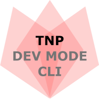

# tnp -> CLI part of taon framework

## Purpose of this project
- this project is a core part of https://github.com/darekf77/taon
- local development of taon

(tnp means "typescript-npm-project" - old name of taon framework)

[TAON DEVELOPER GUIDE - HOW TO USE TNP](./DEVELOPER_GUIDE.md)
