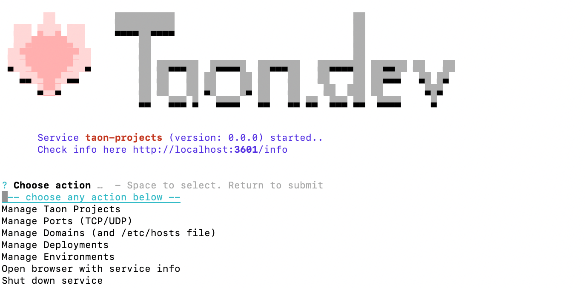
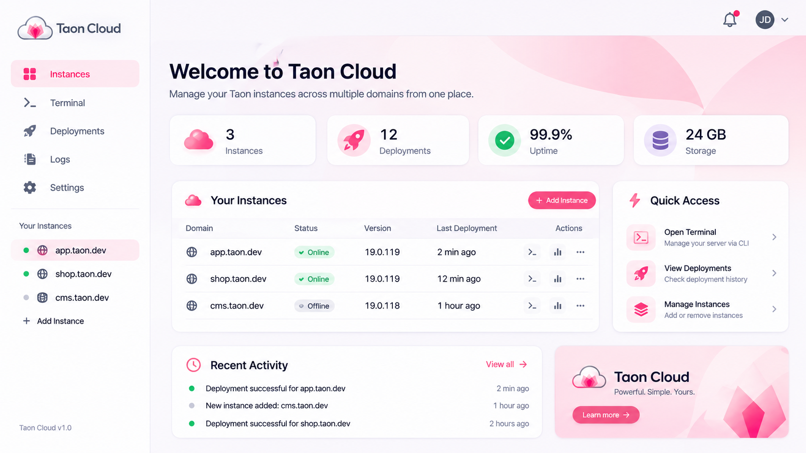
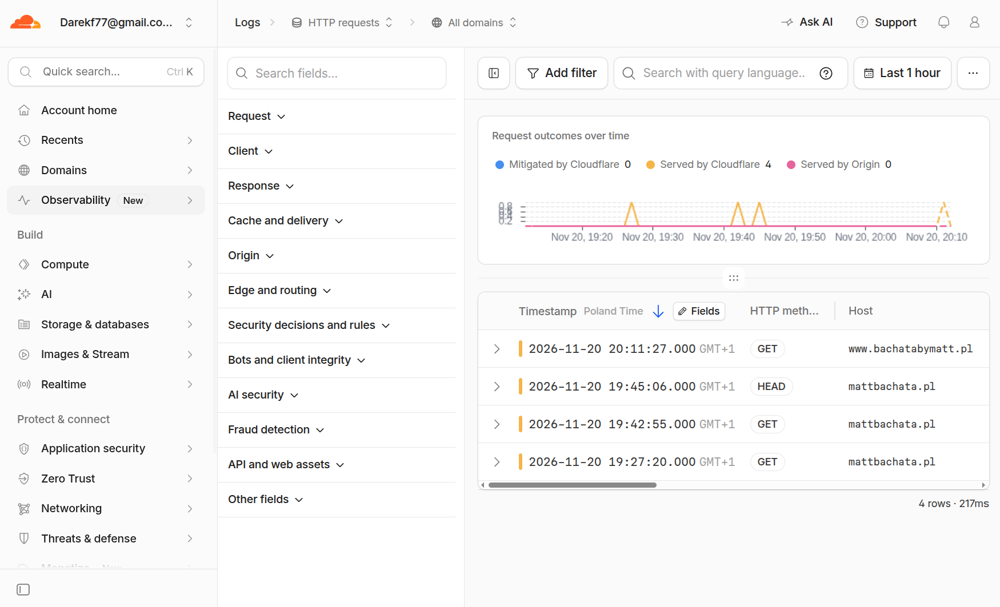

# Taon Cloud

**Taon Cloud is currently under active development.**

However, its foundation is already available through **Taon Service** and the **Taon Cloud Terminal UI**, which you can use today.

Every Taon command integrates with the local service, providing a unified environment for managing projects, ports, databases, builds, processes, and deployments.

The long-term goal is simple: **manage your entire development and deployment infrastructure using the same tools, whether you're working locally or on a remote server.**

## Taon Service

Taon includes a built-in local service that simplifies project management, port allocation, domain configuration, process monitoring, and deployments.

**Taon Service is the foundation of Taon Cloud.** Both share the same core functionality, with additional capabilities depending on whether Taon runs on your local machine or a remote server.

### How it works

Whenever you execute a Taon command, the CLI automatically checks whether a healthy Taon Service instance is running.

If the service is unavailable, Taon launches a dedicated system terminal with its interactive management interface.

The service continues running independently, maintaining information about active projects, allocated ports, databases, builds, and other background processes.

This means you don't have to manually start or configure the service before working with your projects.

## Taon Cloud Terminal UI



**The Taon Cloud Terminal UI brings infrastructure management directly into your terminal.**

It provides a centralized interface for managing local development environments and, eventually, remote servers over SSH.

No browser dashboard is required. You can monitor processes, inspect logs, manage deployments, and control your infrastructure without leaving the terminal.

The terminal-first approach also makes Taon particularly suitable for remote development, headless servers, and automated environments.

## Taon Cloud Web UI

The planned Taon Cloud Web UI will provide an alternative interface for managing the same infrastructure through a browser.

You will be able to install Taon Cloud on any compatible server running Node.js.

### Installation

Install Taon globally:

```bash
npm install -g taon
```

Start the cloud service in detached mode:

```bash
taon cloud:start --detach
```

Once the service is configured, you'll be able to access the Taon Cloud dashboard through your browser.



*Taon Cloud Web UI — proposed interface, currently under development.*

## Features — Localhost vs. Cloud

Taon is designed around a simple principle: **the same management experience should work on your local machine and in the cloud.**

Most features are shared between both environments. The main differences concern networking, domain configuration, and infrastructure deployment.

### 1. Enable or Disable Cloud Infrastructure

**On localhost**

Enable or disable the local infrastructure required for cloud-style deployments.

- Enable or disable Docker-based deployments.
- Start or stop Traefik and related services.
- Test deployment configurations locally before moving to production.

**On a cloud server**

Manage publicly accessible infrastructure, including:

- Reverse proxy configuration.
- Domain routing.
- Automatic SSL certificate provisioning and renewal.
- Secure HTTPS access to deployed applications.

### 2. Project Management

Discover, register, create, and manage Taon projects from a single interface.

- Automatically discover existing projects.
- View, add, and edit registered projects.
- Create new Taon projects.
- Organize projects for deployment.

**Available in both environments:** The same project management workflow is intended to work on localhost and remote Taon Cloud instances.

**Planned:** Integration with domain registrars to simplify domain purchasing and assignment when creating new projects.

### 3. Deployment Management

A centralized place to decide **what to deploy, where to deploy it, and how it should run.**

- Configure deployment targets.
- Deploy individual projects or build artifacts.
- Deploy multiple projects or artifacts as a group.
- Manage deployment configurations.
- Reuse deployment workflows across local and remote environments.

**Localhost:** Prepare, test, and execute deployments using local infrastructure.

**Cloud:** Deploy and manage applications on remote servers using the same workflow.

### 4. Domain Management

Manage domains without repeatedly editing configuration files or manually setting up routing rules.

**On localhost**

- Test domain connectivity using ping.
- Assign local development domains to projects.
- Simulate production-style domains using `/etc/hosts`.
- Test domain routing before deployment.

**On a cloud server**

- Manage domains assigned to deployed applications.
- Configure domain routing through the reverse proxy.
- Use automatically managed SSL certificates.

**Planned:** Direct integration with domain providers to simplify DNS configuration, domain assignment, and routing.

### 5. Automatic Port Management

Stop manually assigning ports to every project.

Taon Service manages port allocation automatically, helping prevent conflicts between projects and background services.

- Automatically assign available ports when starting projects.
- Reuse the same ports for projects in the same location.
- Track ports assigned to applications, services, and Docker containers.
- Reduce the need for manual `--port` configuration.

**Available in both environments:** Port management follows the same principles on localhost and remote servers.

### 6. Process Management and Logs

Monitor the processes running within your Taon environment.

- View active processes.
- Inspect real-time process output.
- Read existing log files.
- Monitor application and service activity.

**Available in both environments:** Manage local processes or inspect processes running on connected Taon Cloud instances.

### 7. Taon Instance Management

Connect multiple Taon instances to create a unified development and deployment environment.

- Add and register Taon instances.
- List available instances.
- Check instance connectivity and health.
- Authenticate connections between instances.
- Connect local and remote Taon installations.

**The goal:** Your local Taon Service can communicate with remote Taon Cloud instances, allowing you to manage distributed infrastructure from a single interface.

### 8. Deployment Scheduler

Automate deployments without requiring a separate CI/CD platform for every project.

- Schedule deployments for a specific date and time.
- Trigger deployments automatically after pushing to a selected Git branch.
- Configure deployment automation for individual projects.

**Available in both environments once implemented:** The scheduler will use the same configuration model for local and remote deployments.

### 9. Settings and Security

Configure how your Taon environment operates and how users access it.

- Configure administrator authentication.
- Enable password-based access.
- Configure two-factor authentication (2FA).
- Manage service-level settings.
- Enable optional infrastructure components, such as Portainer.

**Localhost:** Configure your local Taon Service and development infrastructure.

**Cloud:** Secure access to remote management interfaces and deployed services.

## Cloudflare — Deploy Taon to Production Today

**You don't have to wait for the full Taon Cloud implementation to deploy Taon applications to production.**

Taon already supports deployment to **Cloudflare Workers**, providing a serverless alternative to managing your own infrastructure.

Each Taon project includes a predefined `cloudflare` release task in its `taon.jsonc` configuration.

With a single command, you can build and deploy your application together with its configured Cloudflare infrastructure.

### Cloudflare Infrastructure

Taon integrates with the following Cloudflare services:

- **Cloudflare Workers** — Run your application backend in a serverless environment.
- **Cloudflare D1** — SQL database storage.
- **Cloudflare R2** — Object storage for files and other assets.
- **Cloudflare KV** — Distributed key-value storage for application data.

### Deploy with One Command

```bash
taon ar cloudflare
```

Here, `ar` is an alias for `automatic:release`.

The command executes the project's configured Cloudflare release workflow, building and deploying the application and its associated resources.



## Two Deployment Approaches, One Framework

Taon is designed to support two complementary deployment models.

**Taon Cloud — Self-hosted infrastructure**

Run your applications on your own servers, manage processes and deployments, configure domains, and maintain control over your infrastructure.

Ideal for applications requiring dedicated servers, custom runtime environments, or direct infrastructure access.

**Cloudflare — Serverless infrastructure**

Deploy Taon applications to Cloudflare Workers without maintaining a traditional Node.js server.

Ideal for applications that benefit from managed infrastructure, global distribution, and simplified operations.

Both approaches use the same Taon framework and CLI, allowing you to choose the deployment environment that best suits your project.

**Develop locally. Deploy anywhere. Manage everything with Taon.**
